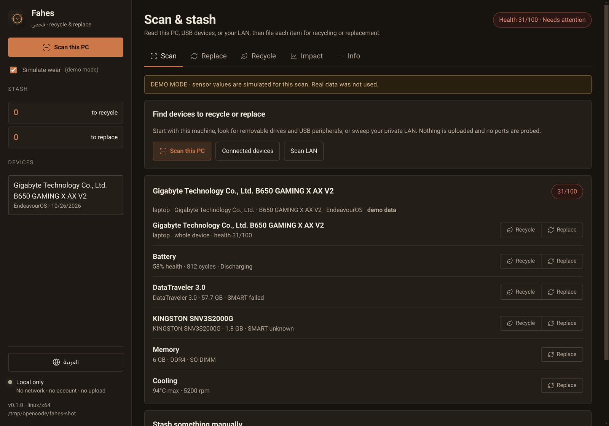
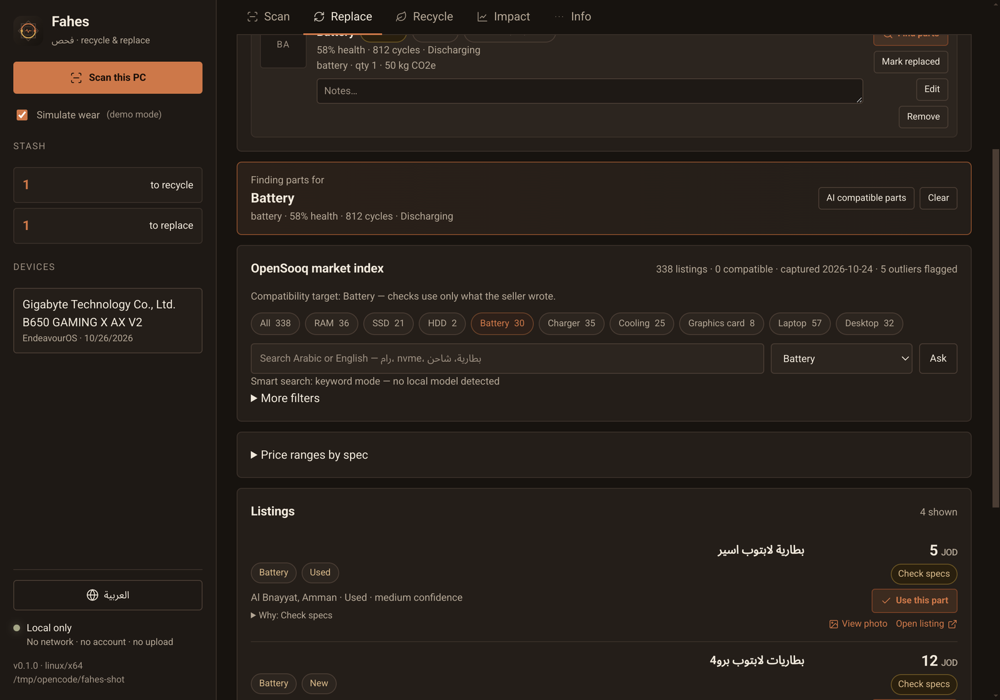
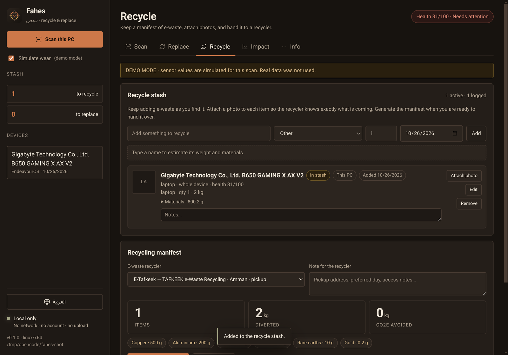

# Fahes · فحص

**A local-first recycle & replace app for laptops, desktops and the devices around them.** Scan this PC, removable
drives, USB peripherals or the local network, then stash each item for **recycling** or **replacement**. Replacement
items search the OpenSooq index for compatible parts; recycling items become a photo-backed PDF manifest for a real
e-waste partner.

No account. No server. No upload. Everything is stored on the machine it runs on.

```bash
# 1. Go into the project directory first — npm must see package.json.
cd Hackathon_bebsi

# 2. Install and run (Linux)
npm install
npm run dev
```

Or use the launcher, which always runs from the repository regardless of your shell's directory:

```bash
./run.sh                 # Linux
```

```powershell
powershell -ExecutionPolicy Bypass -File .\run.ps1   # Windows
```

---

## Why

Most tools stop at “your disk is failing”. Fahes is built around what happens next:

- **Two routes, one stash** — every scanned part or device can be filed under **Recycle** or **Replace**.
- **Replacement with local prices** — compatible parts are matched against 338 real OpenSooq listings and the
  Jordanian price book, with the city and capture date attached.
- **Recycling as a handover document** — attach a photo to each item, generate a manifest PDF with quantities, mass
  and material estimates, then email it to a verified recycler.
- **AI fills filters, not facts** — a small local Ollama model turns a sentence into market filters. Compatibility,
  prices and impact stay deterministic.
- **Scan beyond this PC** — removable drives and USB peripherals, plus a private-LAN sweep for the old router, printer
  or NAS you have been meaning to retire.

> Scan it. Stash it. Replace what is worth keeping, recycle what is not.

---

## Current status

| Area | State |
|---|---|
| Local hardware scan (Linux/Windows) | Working — battery, disks, SMART, RAM, thermals, OS |
| Connected-device scan | Working — removable/USB disks via `lsblk`/CIM, USB peripherals via `lsusb` |
| LAN scan | Working — private /24 ping sweep + ARP/neighbour table; no port probing |
| Recycle stash | Working — manual or scanned items, quantities, notes and local photos |
| Replacement stash | Working — scanned parts or manual entries, AI/keyword market search |
| Recycling manifest PDF | Working — item photos, quantities, mass/material estimates, recycler details, handover declaration |
| Email handover | Working — opens the recycler address with a ready message; attach the saved PDF |
| Jordanian price book | Real, dated prices from GTS (retail) and OpenSooq (used, asking), captured 2026-10-24 |
| Impact ledger | Working — driven by recycled/replaced stash items |
| OpenSooq market index | Working — 338 real listings, Arabic parsing, spec buckets, compatibility filter |
| AI market search | Working — local Ollama if present; deterministic keyword fallback otherwise |
| Arabic mode (RTL) | Working for the UI shell, market, recycling, prices and passport; new scan/recycle prose is English |
| Second-life passport + QR | Working (signed hash, offline verification) |
| Wipe attestation | Working — operator attestation, not proof of erasure |
| Demo mode | Working — simulates wear so a healthy laptop can demo the whole flow |
| AppImage / Windows installer | Config written; needs a build on each OS |

---

## Requirements

- **Node.js 20+** (22 recommended) and npm.
- **Linux:** `smartmontools` for drive health, `lm-sensors` for temperatures. Both are optional — the app
  degrades and tells you the install command for your distro.
  - Arch / Manjaro: `sudo pacman -S smartmontools lm_sensors`
  - Ubuntu / Mint / Debian: `sudo apt install smartmontools lm-sensors`
- **Windows:** nothing extra. Run as administrator for drive reliability counters and thermal zones.

`smartctl` and DMI reads may require elevated access. Fahes does **not** ask for sudo and never runs elevated; it
degrades and prints the exact command you can run yourself.

If Electron's binary did not download during `npm install` (npm 12 blocks install scripts by default), run:

```bash
node node_modules/electron/install.js
```

---

## Run

```bash
npm install
npm run dev          # builds the Electron main process, then opens the app
```

Checks:

```bash
npm run typecheck    # TypeScript, no emit
npm run test:scan    # real hardware scan + demo scan + store/passport round-trip (no GUI)
npm run test:stash   # stash, photo, manifest and ledger round-trip (no GUI)
```

## Package

```bash
npm run pack:linux   # release/Fahes-0.1.0-x86_64.AppImage
npm run pack:win     # release/Fahes-Setup-0.1.0-x64.exe  (run this ON Windows)
```

Cross-building the Windows installer from Linux is not supported here — build it on the Windows laptop.
AppImage needs FUSE 2; on Arch install `libfuse2`, or run with `--appimage-extract-and-run`.

Branding assets live in `build/`: `icon.svg` is the source logo, `icon.png` (512×512) is used by Linux and the dev
window, and `icon.ico` is used by the Windows installer. The in-app copy is `ui/assets/logo.svg`.

---

## Navigation (kept small on purpose)

| Tab | What lives there |
|---|---|
| **Scan** | this PC, connected devices, LAN devices, and a manual add form; every candidate has Recycle and Replace |
| **Replace** | the replacement stash + the OpenSooq search, filters and compatibility badges |
| **Recycle** | the recycle stash, per-item photos, recycler choice, manifest PDF and email handover |
| **Impact** | active stash counts, diverted kilograms, CO₂e avoided and recovered materials |
| **Info** | price book, verified recyclers, second-life passport and data destruction |

Secondary controls sit behind disclosure folds, so the first screen answers one question at a time.

## How it works

```
Electron main process (Node)
  ├─ lib/detect/linux.ts      /sys, lsblk, smartctl, sensors, hwmon, DMI
  ├─ lib/detect/windows.ts    one PowerShell/CIM round-trip → JSON
  ├─ lib/detect/connected.ts  removable/USB disks and USB peripherals
  ├─ lib/detect/lan.ts        private /24 ping sweep + ARP/neighbour table
  ├─ lib/health.ts            health context from the local scan
  ├─ lib/ai.ts                Ollama → validated market filters + keyword fallback
  ├─ lib/store.ts             devices, recycle/replace stash, photos, ledger (mode 0600)
  ├─ electron/recycle-pdf.ts  photo-backed recycling manifest
  └─ lib/passport.ts          hashed, verifiable second-life record
        ↕ IPC (contextIsolation, no node in renderer)
Renderer (plain HTML/CSS/JS)
  └─ ui/                      no frameworks, no network, strict CSP
```

Key design rules:

1. **The data is deterministic.** Compatibility, prices, mass and impact — no model decides anything.
2. **AI fills filters, not facts.** The local model may turn a sentence into search filters; it never invents a part,
   a price or a health score.
3. **Missing data is `unknown`.** Never fabricate a sensor, a score or a price.
4. **Ranges, not false precision.** CO₂e and materials are published estimates with a range.
5. **Local only.** No telemetry, no accounts, no update pings, no remote assets. The LAN sweep stays on the local
   private network and does not probe ports.

## Recycle & replace workflow

1. **Scan.** Run a local hardware scan, scan connected devices, or sweep the private LAN. The local scan offers every
   component (whole device, battery, each drive, memory, cooling) as a stash candidate.
2. **Stash.** Choose **Recycle** or **Replace** for each candidate, or add something manually. Replace items keep the
   detected requirements (DDR generation, SO-DIMM/DIMM, NVMe/SATA) so the market can score compatibility. Every stash
   row can be edited — title, category, detail, quantity, notes and date added. Changing category or quantity
   recomputes the mass/material estimate.

   
3. **Replace.** Open an item in the Replace tab to search the OpenSooq index. **AI compatible parts** sends the item
   to the local model (when one is installed) to fill filters; the deterministic parser is the fallback. Compatibility
   and prices never come from the model.

   
4. **Recycle.** Add a photo to each recycle item, choose a verified recycler, and generate a PDF manifest. The PDF
   contains the items, quantities, photos, mass/material estimates, recycler contact details and a handover
   declaration. The items move to `Recycled` in the ledger; **Email recycler** opens your mail app with the address
   and message so you can attach the saved PDF.

   
5. **Track.** The Impact tab counts what is still stashed, what was recycled or replaced, and the estimated kilograms
   diverted and CO₂e avoided.

The estimates are deliberately conservative: recycling recovers materials, it does not undo manufacturing.

## Data and privacy

- Stored at `app.getPath("userData")/fahes-data.json` — `~/.config/Fahes` on Linux, `%APPDATA%\Fahes` on Windows.
- File mode `0600` where the OS supports it. Delete the file to delete everything.
- Serials are hashed; only the hash is kept.
- The renderer has no network access (`connect-src 'none'` in the CSP) and no Node access.
- The wipe record is an **attestation by the operator**, not a cryptographic proof of erasure. The UI says so.

## The price book (real data)

`data/prices.json` — one row per part, labour or device class. Every row is either **observed** or explicitly marked
`estimate`. There is no invented filler.

```json
{
  "id": "p-ssd-nvme-500-retail",
  "category": "ssd",
  "item": "Kingston NV3 500 GB NVMe SSD",
  "spec": "M.2 2280, PCIe 4.0",
  "low": 89,
  "high": 89,
  "currency": "JOD",
  "unit": "each",
  "kind": "retail",
  "vendor": "GTS (gts.jo)",
  "city": "Amman",
  "source": "GTS product page",
  "sourceDate": "2026-10-24",
  "url": "https://gts.jo/..."
}
```

Where the numbers come from (captured **2026-10-24**, manually, from public pages):

| Kind | Source | Examples |
|---|---|---|
| `retail` | [GTS](https://gts.jo) product pages, JOD | NVMe 500 GB **89**, NVMe 1 TB **135**, SATA 480 GB **69**, DDR4 16 GB SO-DIMM **119**, DDR5 16 GB SO-DIMM **249**, thermal paste **9–14** |
| `used` | [OpenSooq Jordan](https://jo.opensooq.com/en) asking prices | laptop battery **12–35**, 65 W charger **5–20**, 16 GB DDR4 SO-DIMM **45**, used laptop/desktop **60–200** |
| `policy` | [E-Tafkeek](https://e-tafkeek.com/) | MOENV disposal reference **100 JOD/ton** (0.1 JOD/kg) |
| `estimate` | not surveyed yet | shop diagnosis/installation labour **5–15 / 5–10** |

Honest limits:

- GTS prices are **listed prices**; tax and delivery were not verified.
- OpenSooq prices are **asking prices** from classifieds, not warranty-backed shop prices, and individual listings
  change daily. The category URL is stored, not a per-listing snapshot.
- The two labour rows are estimates. The UI marks them `estimate`, and the advisor's cost-per-year includes them —
  so replace them with real quotes before quoting total cost.
- One laptop battery row exists (aftermarket/used, 12–35 JOD). There is **no** invented "OEM battery" price.

The dataset is versioned (`SEED_VERSION` in `lib/store.ts`); when the version changes, the app replaces the stored
price book so stale rows never masquerade as current quotes.

## Market index (OpenSooq)

Classifieds are the real Jordanian price signal, but the listings are vague Arabic with inconsistent specs
("رام لابتوب ddr3 4g", "16GB RAM + 256 SSD", "شاحن بطاقة" — actually a coin cell). `lib/market/` turns them into
something usable.

**What ships:** `data/market-snapshot.json` — **338 unique listings** captured 2026-10-24 from 14 public category and
search pages, each with its URL, price, city and condition. The app works fully offline from the snapshot.

**Parsing pipeline** (`lib/market/parse.ts`):

1. **Arabic normalisation** — diacritics and tatweel removed, `أإآ → ا`, `ى → ي`, `ة → ه`, Arabic-Indic digits
   converted, so `بطارية` and `بطاريه` match.
2. **Category** — RAM, SSD, HDD, battery, charger, cooling, GPU, CPU, motherboard, keyboard, laptop, desktop, other.
3. **Part vs machine** — "لابتوب i5 مع 8GB RAM + 256GB SSD" is a *laptop*, not a RAM stick. Without this, RAM medians
   were inflated to 300–400 JOD.
4. **Variant** — laptop battery vs coin cell, laptop charger vs 220→110V converter, thermal paste vs fan, internal vs
   external drive. Only the relevant variant reaches a price bucket.
5. **Specs** — capacity (GB/TB, Arabic units), DDR generation, form factor (SO-DIMM/DIMM, M.2/2.5"), wattage, brand,
   condition, confidence.
6. **Outliers** — per spec bucket, anything beyond 4× below or 3× above the median is flagged and excluded from
   aggregates (42 of 338 in the current snapshot).

**Compatibility** (`lib/market/compat.ts`) is conservative and derived from the detected machine
(e.g. `DDR5 · SO-DIMM · NVMe · M.2`):

- known mismatch → **incompatible** (wrong DDR generation, DIMM vs SO-DIMM, NVMe vs SATA)
- known match → **compatible**, with the caveat to confirm slot count and M.2 length
- missing data → **check**, never a guess

**UI:** filters for search (Arabic or English), category, condition, max price, parts-only, hide-incompatible and
outliers. Listings sort compatibility-first. Each row shows its normalised tags, confidence, city, and a "why" panel.
Aggregates show median / P25–P75 / n per spec bucket.

### Smart search (optional local model)

Type a sentence and press Enter (or **Ask**): *"ddr4 16gb laptop ram under 100"*.

- If a small Ollama model is installed (`qwen3:4b`, `llama3.2:3b`, `qwen2.5:3b`, `gemma3:4b`), it converts the sentence
  into filters: category, DDR generation, form factor, minimum capacity, max price, condition, keywords.
- **No model required.** A deterministic parser handles the same query, and the UI says
  `Smart search: keyword mode — no local model detected`. Large models (like a 23 GB one on an 8 GB GPU) are ignored
  on purpose so the UI never hangs.
- The parsed filters appear as chips with a **Clear AI filters** button, and the model is named when one answered.

The model only ever fills filters. Compatibility, prices and health stay deterministic.

**Refresh** is opt-in and user-initiated: 14 requests to public OpenSooq pages, no account, no cookies, no personal
data. If it fails or returns nothing, the existing snapshot stays.

### Viewing listing photos


Classifieds live and die by the photo — a label shot often says more than the title. Each listing has its public image
URL; **View photo** fetches that one image on demand and opens it full-size in the app.

- Nothing is preloaded. The snapshot ships titles and prices only; photos load when clicked.
- One request per photo, then cached on disk (`userData/images/`) and in memory for the session.
- The modal shows the photo, the seller's title, price, area and a link to the original listing.
- After the first load, a thumbnail appears in the listing row and reopens instantly from cache.
- Nothing is read or interpreted from the photo — it is there for the human to judge.

## Recycling partners

`data/recyclers.json` holds real drop-off data, shown in the **Recycle** tab.

**E-Tafkeek — TAFKEEK e-Waste Recycling** (Amman)

- Address: Mecca Street, Al Husseini complex 152, 4th floor, office 402
- **Mobile: +962 777194940** — for pickup
- Landlines: +962 6 5511533 · +962 6 5511532
- Email: sudki2023@e-tafkeek.com
- Hours: Saturday–Thursday, 9:00 AM – 4:00 PM
- **Pickup (confirmed):** call the mobile, give a rough count of your devices, send pictures — they send a car to your
  location to collect the components
- Accepts: phones, TVs, computers/laptops, motherboards and PC cards, PCB boards, communications devices, other
  electrical waste
- Also: resells refurbished machines and usable parts (HDD, optical drives, RAM), supplies sorted material to
  smelters, exports non-recycled boards, and supports the MOENV **100 JOD/ton** legal-disposal policy
- Source: <https://e-tafkeek.com/> · contact: <https://e-tafkeek.com/contactus/>

**Al Nasser Group — E-Waste Management** (Amman)

- Address: 7th Circle, Al Husseini Complex, 5th floor, office 512
- Phone: +962 6 5833 166 (landline)
- Email: Sales2@nassergroup.com.jo
- Hours: Sunday–Thursday, 9:00 AM – 4:00 PM
- Pickup: **not confirmed** — their site mentions collection, but the procedure could not be obtained. Call and ask.
- Data destruction: wiping **and physical destruction** of hard drives, SSDs and memory cards (ask explicitly)
- Also: component recovery (metals, plastics, boards), recycling, refurbishment (reusable devices resold or donated),
  environmental compliance, awareness programmes
- Source: <https://nassergroup.com.jo/e-waste-management/> · contact: <https://nassergroup.com.jo/contact-us/>
- Map: <https://maps.app.goo.gl/Fvz8bBdvUZLFJYUz9>

Both partners are listed in the **Recycle** tab. The app tells the user to call, describe the count, send photos, and
ask what happens to data-bearing drives before handing anything over. The wipe attestation exists for exactly that
conversation — and Al Nasser Group is the partner that explicitly offers physical destruction, which is the right
answer when wiping is not enough.

## Demo mode

Healthy laptops produce a boring (and correct) "nothing needs replacing". Tick **Simulate wear** before running a
check to overlay realistic faults — 58% battery, 812 cycles, a **failing SMART status** on the system SSD, 94 °C idle,
6 GB RAM, 96% full disk. That gives the Recycle tab a real reason to exist: it opens with *"Drive reports a failing
SMART status — retire it and recycle it properly below."* The diagnostic is flagged `demo: true`, the UI shows a banner, and the values are never presented as real.

## Known limits

- macOS is not supported.
- Windows sensor coverage varies by vendor; reliability counters may need admin.
- `lsblk` may be missing on minimal installs — there is a sysfs fallback.
- Prices are seed ranges and will be stale; the source/date are shown next to every number.
- No live component shopping links (deliberate: no network).
- The passport verifies integrity, not truthfulness — it proves the record was not altered after issue.

### Passport as a PDF

"Download PDF" on the passport produces a one-page A4 document via Electron's `printToPDF` — no PDF library, no
remote assets:

- QR code, device and health summary
- avoided CO₂e, diverted kilograms, recovered materials
- wipe record (method, date, nonce) or an explicit "no wipe record"
- SHA-256 of the record and a disclaimer that it proves integrity, not condition

It renders in the current language, including RTL Arabic.


## From a scan to a stash

Every scan produces candidates, not a lecture. A laptop scan offers the whole device, the battery, each drive, memory
and cooling; a USB or LAN scan offers the external device. Each row carries two actions:

| Action | What happens next |
|---|---|
| **Recycle** | the item enters the recycle stash, where you can attach a photo, add a note and generate the manifest |
| **Replace** | the item enters the replacement stash, where you can search compatible parts and log the chosen listing |

The recycle manifest includes the **data-destruction warning** and the exact wipe command for each detected drive
(`nvme sanitize`, `hdparm security-erase`, `shred`). A wipe attestation can be recorded in Info → Second-life
passport. Physical destruction is flagged for failing drives.

Market matches exclude price outliers, accessories, wanted/barter ads ("مطلوب", "للبدل") and anything incompatible
with the stashed item. When nothing fits, it says so instead of showing a random part.

## Arabic mode (العربية)


Toggle at the bottom of the sidebar (`العربية` / `English`). The choice is stored in `localStorage`, and the app
switches `lang="ar"` with a full **RTL** layout — sidebar on the right, mirrored lists and table alignment.

Translated so far:

- navigation, buttons, empty state, demo banner, privacy line
- **Market**: search placeholder, filters, category chips, compatibility badges and reasons, counts, hidden-row
  explanations, bucket names, condition and confidence words
- **Recycle**: partner labels, phone types, pickup wording, source/contact links
- **Price book**: table headers, kind labels (retail / used / policy / estimate)
- **Passport**: buttons, wipe panel, status badges
- health item labels (battery, storage, thermals, memory) and severity chips
- toasts

**Still English:** the new scan/stash/manifest prose and the dynamic candidate details (device health, disk models,
partner names). The app states this under the tabs in Arabic mode rather than pretending otherwise. Localising it needs
a `lang` argument flowing through the renderer and `electron/recycle-pdf.ts`, which is the next step if full Arabic is
required.

## Contributing (teammates)

Good places to work without touching the core:

1. **Price book** — survey real shops and replace the seed rows (`data/prices.json`).
2. **Detection coverage** — more device classes and reliable USB/LAN identification, starting in `lib/detect/`.
3. **Windows** — verify `lib/detect/windows.ts` on a real machine and tighten the CIM mappings.
4. **Passport UI** — a verification view that accepts a scanned QR on a second device.
5. **Localisation** — Arabic UI strings (the app is currently English with Arabic branding).
6. **Packaging** — tested AppImage on Arch/Mint, tested NSIS installer on Windows.

Please keep the rules above: no invented numbers, no network calls, no telemetry.

## License

MIT — see `LICENSE`.
