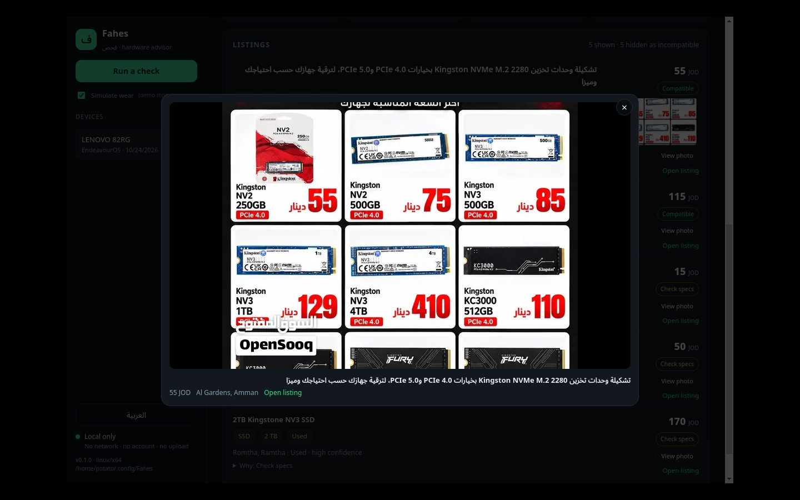
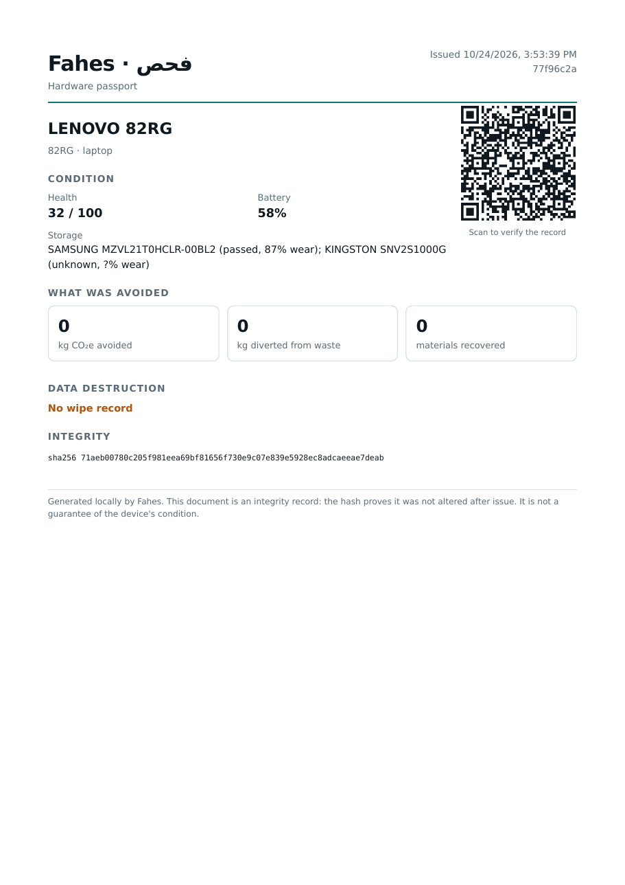
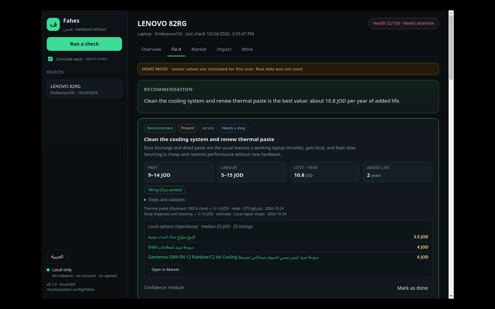
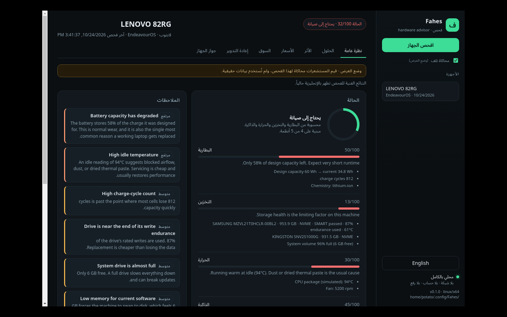

# Fahes · فحص

**A local-first hardware advisor for laptops and desktops.** It reads what your machine can report, then advises
**repair, upgrade, recycle or replace** — priced in Jordanian dinars, measured in years of added life, kilograms
diverted and CO₂e avoided.

No account. No server. No network calls. Everything is stored on the machine it runs on.

```bash
# 1. Go into the project directory first — npm must see package.json.
cd Hackathon_bebsi

# 2. Install and run (Linux)
npm install
npm run dev
```

Or use the launcher, which always runs from the repository regardless of your shell's directory:

```bash
./run.sh                 # Linux
```

```powershell
powershell -ExecutionPolicy Bypass -File .\run.ps1   # Windows
```

---

## Why

Most diagnostic tools tell you a disk is failing. They do not tell you whether it is worth fixing, what the part
costs in Amman, or what happens to the old one. Fahes is built around the decision, not the reading:

- **Repair before replace** — ranked by the waste hierarchy (prevent → reuse → repair → recycle → replace), then by
  cost per year of added life.
- **Jordanian prices with provenance** — every part range carries a city, a source and a capture date.
- **Honest about uncertainty** — missing sensors show as `unknown`, never as zero. Health is scored from what was
  actually measured.
- **Recycling is the last resort** — and when it is the right answer, the app says what to do with the battery and the
  data.

> Diagnostics for the laptop you have. Decisions for the laptop you keep.

---

## Current status

| Area | State |
|---|---|
| Linux detection (Arch, Mint, generic) | Working — sysfs battery, `lsblk`/sysfs disks, `sensors`/hwmon/thermal zones, DMI |
| Windows detection | Working — PowerShell/CIM + storage reliability counters. Verified on a Dell Latitude 5511 (Windows 11): battery from `root\wmi`, NVMe bus identified behind Intel RST, ACPI thermal zones |
| Health scoring + findings | Working |
| Remedy engine (cost/year, CO₂e, materials) | Working |
| Jordanian price book | Real, dated prices from GTS (retail) and OpenSooq (used, asking), captured 2026-10-24. Labour remains an estimate |
| Impact ledger | Working (local JSON) |
| OpenSooq market index | Working — 338 real listings, Arabic parsing, spec buckets, compatibility filter |
| Listing photo viewer | Working — on-demand fetch, local cache, full-size modal |
| Arabic mode (RTL) | Working for the UI shell, market, recycling, prices and passport; scan prose still English |
| Second-life passport + QR | Working (signed hash, offline verification) |
| Wipe attestation | Working — records the method as an **operator attestation**, not proof of erasure |
| Demo mode | Working — simulates wear so a healthy laptop can demo the full advisor |
| AppImage / Windows installer | Config written; needs a build on each OS |

---

## Requirements

- **Node.js 20+** (22 recommended) and npm.
- **Linux:** `smartmontools` for drive health, `lm-sensors` for temperatures. Both are optional — the app
  degrades and tells you the install command for your distro.
  - Arch / Manjaro: `sudo pacman -S smartmontools lm_sensors`
  - Ubuntu / Mint / Debian: `sudo apt install smartmontools lm-sensors`
- **Windows:** nothing extra. Run as administrator for drive reliability counters and thermal zones.

`smartctl` and DMI reads may require elevated access. Fahes does **not** ask for sudo and never runs elevated; it
degrades and prints the exact command you can run yourself.

If Electron's binary did not download during `npm install` (npm 12 blocks install scripts by default), run:

```bash
node node_modules/electron/install.js
```

---

## Run

```bash
npm install
npm run dev          # builds the Electron main process, then opens the app
```

Checks:

```bash
npm run typecheck    # TypeScript, no emit
npm run test:scan    # real hardware scan + demo scan + store/passport round-trip (no GUI)
```

## Package

```bash
npm run pack:linux   # release/Fahes-0.1.0-x86_64.AppImage
npm run pack:win     # release/Fahes-Setup-0.1.0-x64.exe  (run this ON Windows)
```

Cross-building the Windows installer from Linux is not supported here — build it on the Windows laptop.
AppImage needs FUSE 2; on Arch install `libfuse2`, or run with `--appimage-extract-and-run`.

Branding assets live in `build/`: `icon.svg` is the source logo, `icon.png` (512×512) is used by Linux and the dev
window, and `icon.ico` is used by the Windows installer. The in-app copy is `ui/assets/logo.svg`.

---

## Navigation (kept small on purpose)

| Tab | What lives there |
|---|---|
| **Overview** | health ring, findings, and collapsed "This machine" / "Sensor notes" |
| **Fix it** | one recommendation, remedies with local market options, collapsed replacement baseline and decision log |
| **Market** | search + category chips; extra filters and price ranges are behind folds |
| **Recycle** | retire-or-repair verdict, per-drive destruction commands, wipe attestation, pickup message, partners |
| **Impact** | avoided spend, CO₂e, diverted kilograms, recovered materials |
| **More** | price book and the second-life passport |

Secondary controls sit behind disclosure folds, so the first screen answers one question at a time.

## How it works

```
Electron main process (Node)
  ├─ lib/detect/linux.ts     /sys, lsblk, smartctl, sensors, hwmon, DMI
  ├─ lib/detect/windows.ts   one PowerShell/CIM round-trip → JSON
  ├─ lib/health.ts           component scores, findings, confidence
  ├─ lib/advisor.ts          remedy ladder + cost/year + impact
  ├─ lib/green.ts            embodied carbon, materials, impact math
  ├─ lib/store.ts            local JSON store (mode 0600)
  └─ lib/passport.ts         hashed, verifiable second-life record
        ↕ IPC (contextIsolation, no node in renderer)
Renderer (plain HTML/CSS/JS)
  └─ ui/                     no frameworks, no network, strict CSP
```

Key design rules:

1. **The decision is deterministic.** Cost per year, waste hierarchy, impact — no model decides anything.
2. **Missing data is `unknown`.** Never fabricate a sensor, a score or a price.
3. **Ranges, not false precision.** CO₂e and materials are published estimates with a range.
4. **Recycling is ranked last.** Reuse and repair are almost always better financially and environmentally.
5. **Local only.** No telemetry, no accounts, no update pings, no remote assets.

## Data and privacy

- Stored at `app.getPath("userData")/fahes-data.json` — `~/.config/Fahes` on Linux, `%APPDATA%\Fahes` on Windows.
- File mode `0600` where the OS supports it. Delete the file to delete everything.
- Serials are hashed; only the hash is kept.
- The renderer has no network access (`connect-src 'none'` in the CSP) and no Node access.
- The wipe record is an **attestation by the operator**, not a cryptographic proof of erasure. The UI says so.

## The price book (real data)

`data/prices.json` — one row per part, labour or device class. Every row is either **observed** or explicitly marked
`estimate`. There is no invented filler.

```json
{
  "id": "p-ssd-nvme-500-retail",
  "category": "ssd",
  "item": "Kingston NV3 500 GB NVMe SSD",
  "spec": "M.2 2280, PCIe 4.0",
  "low": 89,
  "high": 89,
  "currency": "JOD",
  "unit": "each",
  "kind": "retail",
  "vendor": "GTS (gts.jo)",
  "city": "Amman",
  "source": "GTS product page",
  "sourceDate": "2026-10-24",
  "url": "https://gts.jo/..."
}
```

Where the numbers come from (captured **2026-10-24**, manually, from public pages):

| Kind | Source | Examples |
|---|---|---|
| `retail` | [GTS](https://gts.jo) product pages, JOD | NVMe 500 GB **89**, NVMe 1 TB **135**, SATA 480 GB **69**, DDR4 16 GB SO-DIMM **119**, DDR5 16 GB SO-DIMM **249**, thermal paste **9–14** |
| `used` | [OpenSooq Jordan](https://jo.opensooq.com/en) asking prices | laptop battery **12–35**, 65 W charger **5–20**, 16 GB DDR4 SO-DIMM **45**, used laptop/desktop **60–200** |
| `policy` | [E-Tafkeek](https://e-tafkeek.com/) | MOENV disposal reference **100 JOD/ton** (0.1 JOD/kg) |
| `estimate` | not surveyed yet | shop diagnosis/installation labour **5–15 / 5–10** |

Honest limits:

- GTS prices are **listed prices**; tax and delivery were not verified.
- OpenSooq prices are **asking prices** from classifieds, not warranty-backed shop prices, and individual listings
  change daily. The category URL is stored, not a per-listing snapshot.
- The two labour rows are estimates. The UI marks them `estimate`, and the advisor's cost-per-year includes them —
  so replace them with real quotes before quoting total cost.
- One laptop battery row exists (aftermarket/used, 12–35 JOD). There is **no** invented "OEM battery" price.

The dataset is versioned (`SEED_VERSION` in `lib/store.ts`); when the version changes, the app replaces the stored
price book so stale rows never masquerade as current quotes.

## Market index (OpenSooq)

Classifieds are the real Jordanian price signal, but the listings are vague Arabic with inconsistent specs
("رام لابتوب ddr3 4g", "16GB RAM + 256 SSD", "شاحن بطاقة" — actually a coin cell). `lib/market/` turns them into
something usable.

**What ships:** `data/market-snapshot.json` — **338 unique listings** captured 2026-10-24 from 14 public category and
search pages, each with its URL, price, city and condition. The app works fully offline from the snapshot.

**Parsing pipeline** (`lib/market/parse.ts`):

1. **Arabic normalisation** — diacritics and tatweel removed, `أإآ → ا`, `ى → ي`, `ة → ه`, Arabic-Indic digits
   converted, so `بطارية` and `بطاريه` match.
2. **Category** — RAM, SSD, HDD, battery, charger, cooling, GPU, CPU, motherboard, keyboard, laptop, desktop, other.
3. **Part vs machine** — "لابتوب i5 مع 8GB RAM + 256GB SSD" is a *laptop*, not a RAM stick. Without this, RAM medians
   were inflated to 300–400 JOD.
4. **Variant** — laptop battery vs coin cell, laptop charger vs 220→110V converter, thermal paste vs fan, internal vs
   external drive. Only the relevant variant reaches a price bucket.
5. **Specs** — capacity (GB/TB, Arabic units), DDR generation, form factor (SO-DIMM/DIMM, M.2/2.5"), wattage, brand,
   condition, confidence.
6. **Outliers** — per spec bucket, anything beyond 4× below or 3× above the median is flagged and excluded from
   aggregates (42 of 338 in the current snapshot).

**Compatibility** (`lib/market/compat.ts`) is conservative and derived from the detected machine
(e.g. `DDR5 · SO-DIMM · NVMe · M.2`):

- known mismatch → **incompatible** (wrong DDR generation, DIMM vs SO-DIMM, NVMe vs SATA)
- known match → **compatible**, with the caveat to confirm slot count and M.2 length
- missing data → **check**, never a guess

**UI:** filters for search (Arabic or English), category, condition, max price, parts-only, hide-incompatible and
outliers. Listings sort compatibility-first. Each row shows its normalised tags, confidence, city, and a "why" panel.
Aggregates show median / P25–P75 / n per spec bucket.

### Smart search (optional local model)

Type a sentence and press Enter (or **Ask**): *"ddr4 16gb laptop ram under 100"*.

- If a small Ollama model is installed (`qwen3:4b`, `llama3.2:3b`, `qwen2.5:3b`, `gemma3:4b`), it converts the sentence
  into filters: category, DDR generation, form factor, minimum capacity, max price, condition, keywords.
- **No model required.** A deterministic parser handles the same query, and the UI says
  `Smart search: keyword mode — no local model detected`. Large models (like a 23 GB one on an 8 GB GPU) are ignored
  on purpose so the UI never hangs.
- The parsed filters appear as chips with a **Clear AI filters** button, and the model is named when one answered.

The model only ever fills filters. Compatibility, prices and health stay deterministic.

**Refresh** is opt-in and user-initiated: 14 requests to public OpenSooq pages, no account, no cookies, no personal
data. If it fails or returns nothing, the existing snapshot stays.

### Viewing listing photos



Classifieds live and die by the photo — a label shot often says more than the title. Each listing has its public image
URL; **View photo** fetches that one image on demand and opens it full-size in the app.

- Nothing is preloaded. The snapshot ships titles and prices only; photos load when clicked.
- One request per photo, then cached on disk (`userData/images/`) and in memory for the session.
- The modal shows the photo, the seller's title, price, area and a link to the original listing.
- After the first load, a thumbnail appears in the listing row and reopens instantly from cache.
- Nothing is read or interpreted from the photo — it is there for the human to judge.

## Recycling partners

`data/recyclers.json` holds real drop-off data, shown in the **Recycle** tab.

**E-Tafkeek — TAFKEEK e-Waste Recycling** (Amman)

- Address: Mecca Street, Al Husseini complex 152, 4th floor, office 402
- **Mobile: +962 777194940** — for pickup
- Landlines: +962 6 5511533 · +962 6 5511532
- Email: sudki2023@e-tafkeek.com
- Hours: Saturday–Thursday, 9:00 AM – 4:00 PM
- **Pickup (confirmed):** call the mobile, give a rough count of your devices, send pictures — they send a car to your
  location to collect the components
- Accepts: phones, TVs, computers/laptops, motherboards and PC cards, PCB boards, communications devices, other
  electrical waste
- Also: resells refurbished machines and usable parts (HDD, optical drives, RAM), supplies sorted material to
  smelters, exports non-recycled boards, and supports the MOENV **100 JOD/ton** legal-disposal policy
- Source: <https://e-tafkeek.com/> · contact: <https://e-tafkeek.com/contactus/>

**Al Nasser Group — E-Waste Management** (Amman)

- Address: 7th Circle, Al Husseini Complex, 5th floor, office 512
- Phone: +962 6 5833 166 (landline)
- Email: Sales2@nassergroup.com.jo
- Hours: Sunday–Thursday, 9:00 AM – 4:00 PM
- Pickup: **not confirmed** — their site mentions collection, but the procedure could not be obtained. Call and ask.
- Data destruction: wiping **and physical destruction** of hard drives, SSDs and memory cards (ask explicitly)
- Also: component recovery (metals, plastics, boards), recycling, refurbishment (reusable devices resold or donated),
  environmental compliance, awareness programmes
- Source: <https://nassergroup.com.jo/e-waste-management/> · contact: <https://nassergroup.com.jo/contact-us/>
- Map: <https://maps.app.goo.gl/Fvz8bBdvUZLFJYUz9>

Both partners are listed in the **Recycle** tab. The app tells the user to call, describe the count, send photos, and
ask what happens to data-bearing drives before handing anything over. The wipe attestation exists for exactly that
conversation — and Al Nasser Group is the partner that explicitly offers physical destruction, which is the right
answer when wiping is not enough.

## Demo mode

Healthy laptops produce a boring (and correct) "nothing needs replacing". Tick **Simulate wear** before running a
check to overlay realistic faults — 58% battery, 812 cycles, a **failing SMART status** on the system SSD, 94 °C idle,
6 GB RAM, 96% full disk. That gives the Recycle tab a real reason to exist: it opens with *"Drive reports a failing
SMART status — retire it and recycle it properly below."* The diagnostic is flagged `demo: true`, the UI shows a banner, and the values are never presented as real.

## Known limits

- macOS is not supported.
- Windows sensor coverage varies by vendor; reliability counters may need admin.
- `lsblk` may be missing on minimal installs — there is a sysfs fallback.
- Prices are seed ranges and will be stale; the source/date are shown next to every number.
- No live component shopping links (deliberate: no network).
- The passport verifies integrity, not truthfulness — it proves the record was not altered after issue.

### Passport as a PDF

"Download PDF" on the passport produces a one-page A4 document via Electron's `printToPDF` — no PDF library, no
remote assets:

- QR code, device and health summary
- avoided CO₂e, diverted kilograms, recovered materials
- wipe record (method, date, nonce) or an explicit "no wipe record"
- SHA-256 of the record and a disclaimer that it proves integrity, not condition

It renders in the current language, including RTL Arabic.



## From a fault to a fix



The diagnosis and the market used to be separate tabs. Now every remedy carries its own local options, matched against
the detected machine:

| Remedy | What it pulls from the market index |
|---|---|
| Replace the failing drive | SSDs of 240 GB+, filtered by the detected bus (NVMe/SATA) and form factor |
| Add memory | RAM with the right generation and SO-DIMM/DIMM form factor |
| Replace the battery | Laptop battery listings (coin cells excluded) |
| Cooling service | Thermal paste and fan listings |
| Replace the whole device | Used laptops/desktops near the median price, not the cheapest junk |
| Recycle it properly | The real partners, with phone numbers and pickup status |

The recycle card also carries the **data-destruction step**: the exact command for each detected drive
(`nvme sanitize`, `hdparm security-erase`, `shred`), a one-click wipe attestation, and a pickup message you can copy and
send. Physical destruction is flagged for failing drives.

Each block shows the **median and the number of listings**, then the three best options with prices. "Open in Market"
jumps to the market tab already filtered to that category.

Matches exclude price outliers, accessories, wanted/barter ads ("مطلوب", "للبدل") and anything incompatible with the
machine. When nothing fits, it says so instead of showing a random part.

## Arabic mode (العربية)



Toggle at the bottom of the sidebar (`العربية` / `English`). The choice is stored in `localStorage`, and the app
switches `lang="ar"` with a full **RTL** layout — sidebar on the right, mirrored lists and table alignment.

Translated so far:

- navigation, buttons, empty state, demo banner, privacy line
- **Market**: search placeholder, filters, category chips, compatibility badges and reasons, counts, hidden-row
  explanations, bucket names, condition and confidence words
- **Recycle**: partner labels, phone types, pickup wording, source/contact links
- **Price book**: table headers, kind labels (retail / used / policy / estimate)
- **Passport**: buttons, wipe panel, status badges
- health item labels (battery, storage, thermals, memory) and severity chips
- toasts

**Still English:** the technical prose produced by the scan — health summaries, fault titles and details, remedy
titles, descriptions, steps and warnings. The app states this under the tabs in Arabic mode rather than pretending
otherwise. Localising it needs a `lang` argument flowing into `lib/health.ts` and `lib/advisor.ts`, which is the next
step if full Arabic is required.

## Contributing (teammates)

Good places to work without touching the core:

1. **Price book** — survey real shops and replace the seed rows (`data/prices.json`).
2. **Fault trees** — device classes beyond laptops/desktops, starting in `lib/health.ts` + `lib/advisor.ts`.
3. **Windows** — verify `lib/detect/windows.ts` on a real machine and tighten the CIM mappings.
4. **Passport UI** — a verification view that accepts a scanned QR on a second device.
5. **Localisation** — Arabic UI strings (the app is currently English with Arabic branding).
6. **Packaging** — tested AppImage on Arch/Mint, tested NSIS installer on Windows.

Please keep the rules above: no invented numbers, no network calls, no telemetry.

## License

MIT — see `LICENSE`.
